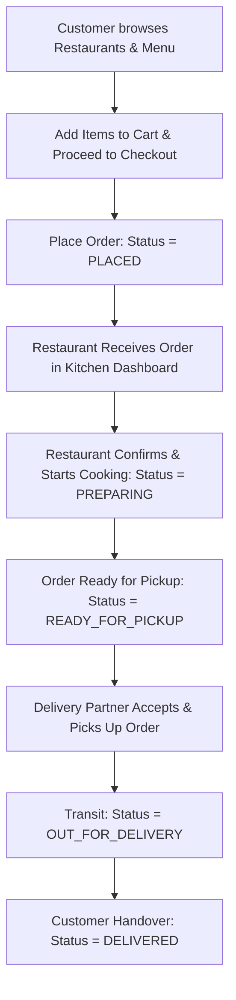

# QuickBite — Full-Stack Online Food Ordering System

A comprehensive, production-ready Full-Stack Food Ordering & Delivery Management application built with **Java 21 Spring Boot**, **React.js**, **Spring Data JPA & Hibernate**, **MySQL**, and **Spring Security with JWT authentication**.

---

## 📖 Abstract

The **Food Ordering System** is designed to provide a convenient, seamless platform for customers to browse restaurants, explore categorized menus, manage food baskets, place orders, and track real-time delivery progress. 

The application provides end-to-end role-based access control (RBAC) across three primary personas:
1. **Customers**: Search restaurants by cuisine, view dishes, customize carts, checkout with multiple payment methods, and follow live order status timelines.
2. **Restaurant Administrators**: Manage restaurant profile, toggle open/close status, add and edit dishes, toggle inventory availability, and update incoming kitchen orders.
3. **Delivery Personnel**: View dispatched orders, accept pickups, navigate to locations, and update real-time transit status until final handover.

---

## 🛠️ Technology Stack

| Layer | Technologies |
|---|---|
| **Frontend** | React 18, Vite, Tailwind CSS, Lucide Icons, Axios, React Router DOM |
| **Backend** | Java 21 LTS, Spring Boot 3.3.4, Spring Web, Spring Data JPA, Hibernate, Spring Security 6 |
| **Security** | JSON Web Tokens (JJWT 0.12.5), BCrypt Password Hashing, Role-Based Access Control |
| **Database** | MySQL 8.0, InnoDB Engine, JPA Auto-DDL |
| **Build Tools** | Apache Maven 3.9+, Node.js 24+, npm |

---

## 🏗️ Architecture & Order Lifecycle Flow



---

## 🔐 Pre-Seeded Demo Credentials

The database automatically initializes with sample users, restaurants, categorized dishes, and active orders upon startup. You can test all 3 roles using the 1-click demo buttons on the login page:

| Role | Email | Password | Full Name |
|---|---|---|---|
| **Customer** | `customer@foodie.com` | `password123` | Rahul Sharma |
| **Restaurant Admin** | `admin@foodie.com` | `password123` | Chef Antonio Rossi |
| **Delivery Courier** | `delivery@foodie.com` | `password123` | Vikram Singh |

---

## 🚀 Quick Start Instructions

### 1. Prerequisites
- **Java 21+** (`java -version`)
- **Maven 3.8+** (`mvn -version`)
- **Node.js 18+** & **npm** (`node -v`)
- **MySQL 8.0** running locally on port 3306

### 2. MySQL Database Setup
Open your MySQL terminal or Workbench and run:
```sql
CREATE DATABASE IF NOT EXISTS food_ordering_db;
```
*(The default `application.properties` connects with `root` / `root`. Adjust the password in `backend/src/main/resources/application.properties` if your MySQL root password is different).*

### 3. Launching the Application (Windows 1-Click)
Simply double-click the included batch script:
```bat
run_project.bat
```
This automatically boots the Spring Boot backend on port `8080`, launches the React Vite frontend on port `5173`, and opens `http://localhost:5173` in your default browser.

### 4. Running Manually via Command Line

**Terminal 1 (Backend):**
```bash
cd backend
mvn spring-boot:run
```

**Terminal 2 (Frontend):**
```bash
cd frontend
npm install
npm run dev
```

---

## 🌐 REST API Endpoints Overview

### Authentication (`/api/auth`)
- `POST /api/auth/register` — Register a customer, restaurant owner, or courier
- `POST /api/auth/login` — Login and receive JWT access token
- `GET  /api/auth/me` — Retrieve current authenticated profile

### Restaurants (`/api/restaurants`)
- `GET  /api/restaurants` — List all restaurants or search with `?query=`
- `GET  /api/restaurants/{id}` — Get restaurant details by ID
- `GET  /api/restaurants/my-restaurant` — Get restaurant for logged-in admin
- `POST /api/restaurants` — Create a restaurant (Admin)
- `PUT  /api/restaurants/{id}` — Update restaurant profile (Admin)

### Food Items (`/api/food-items`)
- `GET    /api/food-items/restaurant/{id}` — Fetch menu items for a restaurant
- `POST   /api/food-items/restaurant/{id}` — Add a new food item (Admin)
- `PUT    /api/food-items/{id}` — Update dish details (Admin)
- `PATCH  /api/food-items/{id}/availability` — Toggle dish in/out of stock (Admin)
- `DELETE /api/food-items/{id}` — Delete a menu item (Admin)

### Orders & Tracking (`/api/orders`)
- `POST  /api/orders` — Create and place a new order (Customer)
- `GET   /api/orders/track/{orderNumber}` — Real-time live status tracking
- `GET   /api/orders/my-orders` — Customer order history
- `GET   /api/orders/restaurant/{id}` — Kitchen active order manager
- `GET   /api/orders/available-deliveries` — Available courier pickup pool
- `GET   /api/orders/my-deliveries` — Active courier assignments
- `PATCH /api/orders/{id}/status` — Advance order status
- `PATCH /api/orders/{id}/assign-delivery` — Accept delivery task

---

## 📦 Version Control (Git)
To push this project to your GitHub repository:
```bash
git remote set-url origin https://github.com/akshithreddythalakatla/foodordering_system.git
git branch -M main
git push -u origin main
```
